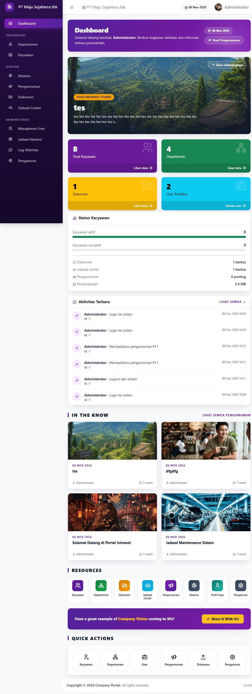
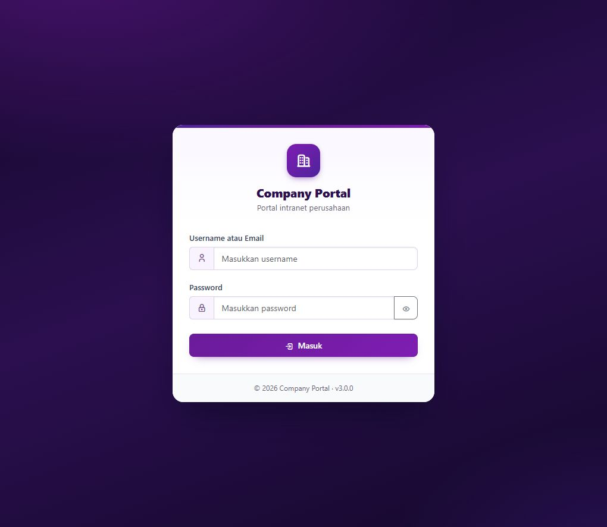
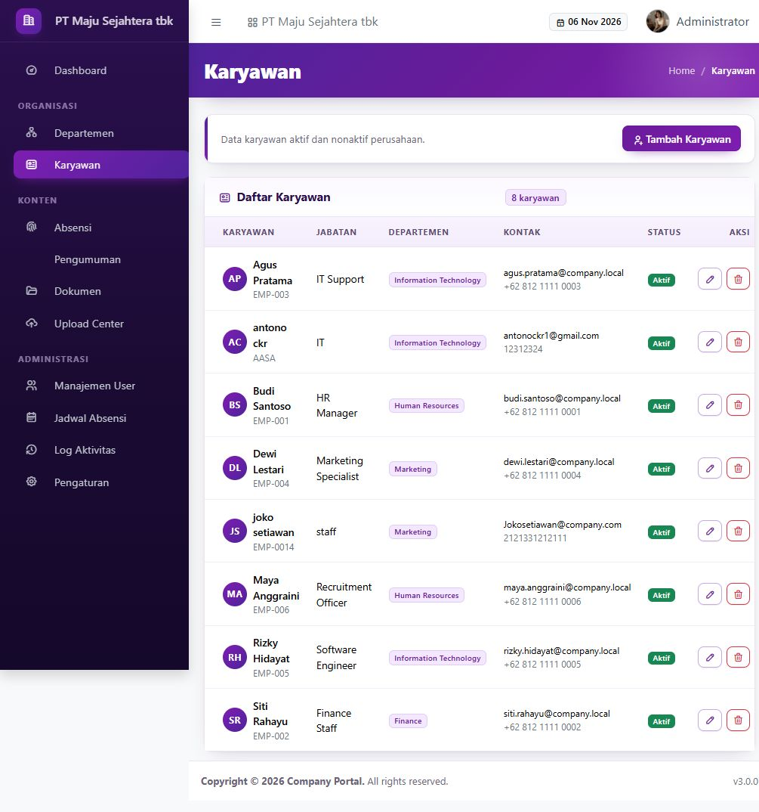
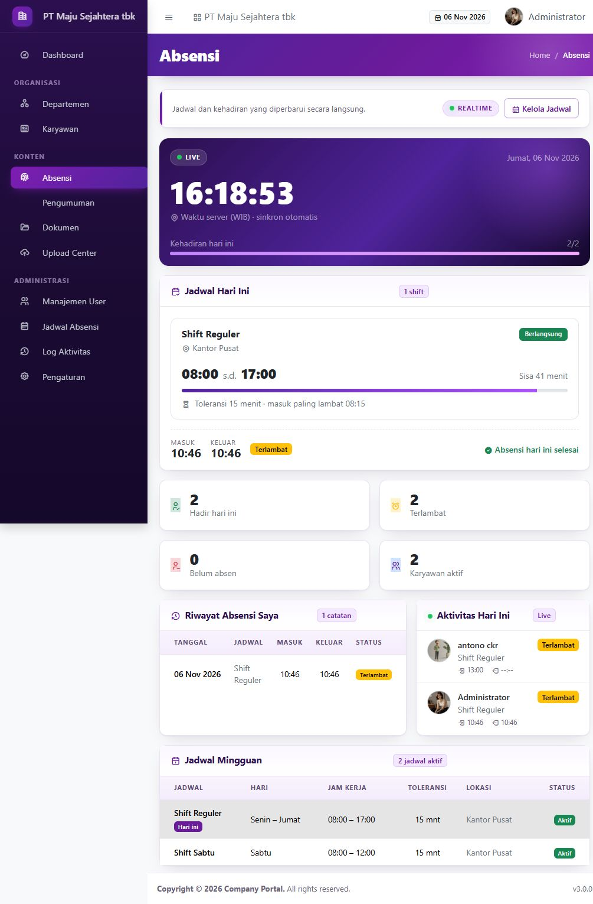
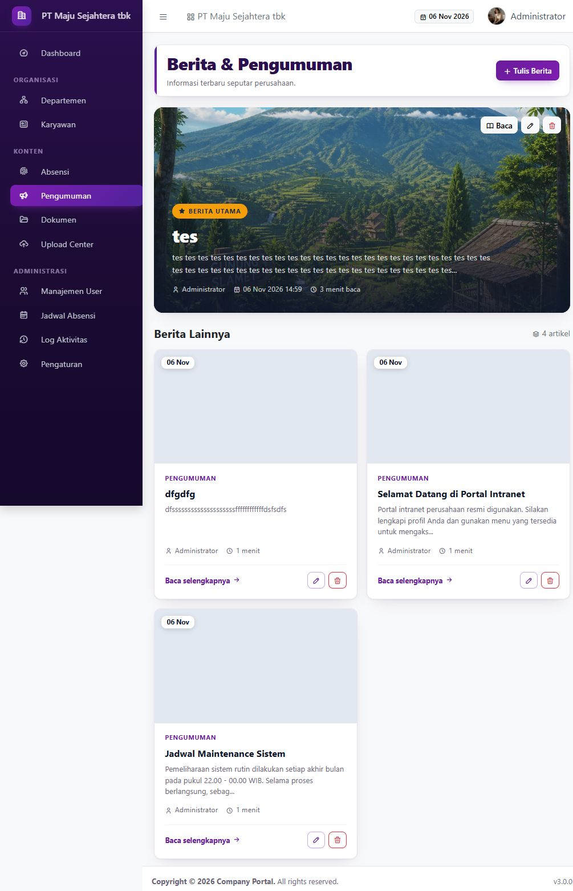
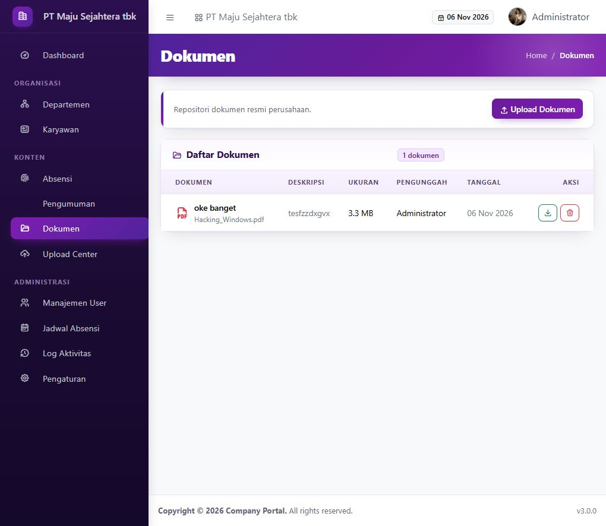

# Company Portal (Intranet)

Aplikasi intranet perusahaan berbasis **PHP 8 + MySQL/MariaDB** dengan tampilan
**AdminLTE 4** (Bootstrap 5). Seluruh aset dilayani secara lokal, tanpa CDN.

## Fitur

- Login/logout dengan proteksi CSRF dan pembatasan percobaan akses
- Dashboard ringkasan (karyawan, departemen, dokumen, user, aktivitas)
- Manajemen Departemen (CRUD)
- Manajemen Karyawan (CRUD)
- Pengumuman (CRUD) dengan gambar sampul dan halaman berita (daftar + detail)
- Repositori Dokumen (unggah, unduh, hapus)
- Upload Center untuk berbagi berkas internal
- **Semua data tersimpan di MySQL**, termasuk foto profil, gambar pengumuman,
  dokumen, dan berkas Upload Center (kolom `LONGBLOB` pada tabel `media`)
- Absensi realtime: jam server WIB, jadwal shift hari ini, absen masuk/keluar,
  status tepat waktu/terlambat, ringkasan dan aktivitas yang diperbarui otomatis
- Jadwal Absensi (admin only): CRUD shift, hari kerja, jam kerja, toleransi
  keterlambatan, lokasi, dan status aktif
- Manajemen User + role admin/user (admin only)
- Log Aktivitas (admin only)
- Pengaturan perusahaan (admin only)
- Profil, foto profil, dan Ganti Password

## Tampilan Aplikasi

<table>
  <tr>
    <td width="50%"><br><sub><b>Dashboard</b> — ringkasan data, aktivitas, pengumuman, dan pintasan</sub></td>
    <td width="50%"><br><sub><b>Login</b> — autentikasi dengan proteksi CSRF</sub></td>
  </tr>
  <tr>
    <td width="50%"><br><sub><b>Karyawan</b> — daftar karyawan aktif dan nonaktif</sub></td>
    <td width="50%"><br><sub><b>Absensi</b> — jam realtime, shift, dan riwayat kehadiran</sub></td>
  </tr>
  <tr>
    <td width="50%"><br><sub><b>Pengumuman</b> — berita utama dan artikel perusahaan</sub></td>
    <td width="50%"><br><sub><b>Dokumen</b> — repositori dokumen resmi perusahaan</sub></td>
  </tr>
</table>

## Kebutuhan

- PHP 8.1+ dengan ekstensi `pdo_mysql`, `mbstring`, `fileinfo`
- MySQL 5.7+ / MariaDB 10.4+
- Apache dengan `mod_rewrite` (XAMPP sudah memenuhi)

## Struktur

```
app/
  Config/        Konfigurasi aplikasi
  Controllers/   Controller per modul
  Core/          Bootstrap, Router, Auth, Csrf, Database, Model, Uploader, dll.
  Models/        Model data
  Views/         Layout AdminLTE 4 + halaman
config/
  database.php   Kredensial database
database/
  schema.sql     Skema tabel (termasuk tabel media LONGBLOB)
  seed.php       Seeder CLI (data contoh)
  migrate_media.php  Migrasi berkas lama dari folder uploads ke MySQL
install/
  index.php      Installer web
public/
  index.php      Front controller
  assets/        Bootstrap, AdminLTE, Tabler Icons, CSS/JS aplikasi
storage/
  logs/          Log PHP
  sessions/      File sesi
```

## Instalasi

### Cara 1 - Installer web

1. Salin folder ini ke `C:\xampp\htdocs\INTRANETPORTAL`.
2. Jalankan Apache dan MySQL dari XAMPP Control Panel.
3. Buka `http://localhost/INTRANETPORTAL/install/`.
4. Isi koneksi database dan akun administrator, lalu klik **Pasang Sekarang**.
5. Buka `http://localhost/INTRANETPORTAL/login`.

### Cara 2 - Seeder CLI

```powershell
cd C:\xampp\htdocs\INTRANETPORTAL
php database/seed.php
```

Seeder membuat database `company_portal`, skema, dan data contoh termasuk akun
administrator default serta dua jadwal absensi (`Shift Reguler` Senin–Jumat
08.00–17.00 dan `Shift Sabtu` 08.00–12.00, toleransi 15 menit).

> **Peringatan:** `seed.php` menjalankan `DROP TABLE` pada tabel aplikasi.
> Jangan jalankan pada database yang sudah berisi data produksi.

### Migrasi berkas lama ke MySQL

Instalasi lama yang masih menyimpan berkas di `storage/uploads/` dapat dipindahkan
ke database tanpa kehilangan data:

```powershell
cd C:\xampp\htdocs\INTRANETPORTAL
php database/migrate_media.php
```

Skrip menyalin isi berkas ke tabel `media`, menghubungkan ulang kolom
`photo_id` / `image_id` / `media_id`, lalu menghapus kolom path lama. Skrip aman
dijalankan ulang dan berhenti tanpa menghapus kolom jika ada berkas yang hilang.
Setelah memastikan aplikasi berjalan, cadangan lama di `storage/uploads/` boleh
dihapus.

## Akun default (hasil seeder)

| Username | Password   | Role  |
|----------|------------|-------|
| `admin`  | `admin123` | admin |

Segera ganti password setelah login pertama melalui menu **Profil > Ganti Password**.

## Modul Absensi

Menu **Absensi** dapat diakses semua user yang sudah login. Halaman ini menampilkan:

- Jam server (zona waktu `Asia/Jakarta`) yang berjalan setiap detik.
- Shift yang berlaku pada hari ini beserta progres dan sisa waktunya.
- Tombol **Absen Masuk** dan **Absen Keluar** (satu catatan per user per hari).
- Ringkasan kehadiran, riwayat absensi pribadi, dan aktivitas hari ini.
- Jadwal mingguan seluruh shift aktif.

Status absensi ditentukan otomatis: absen masuk setelah
`jam_mulai + toleransi` dicatat sebagai **Terlambat**, selain itu **Tepat Waktu**.
Absen masuk memakai shift yang sedang berlangsung, lalu shift berikutnya, lalu
shift pertama hari itu.

Data realtime diambil dari endpoint `GET /attendance/status` (JSON) setiap 10 detik,
sehingga ringkasan dan aktivitas diperbarui tanpa memuat ulang halaman. Responsnya
memuat jadwal hari ini, catatan absensi user, ringkasan, dan feed aktivitas.

Menu **Jadwal Absensi** (sidebar bagian Administrasi) hanya untuk admin dan
mendukung CRUD shift: nama, hari kerja, jam mulai/selesai, toleransi keterlambatan
(0–180 menit), lokasi, dan status aktif. Shift nonaktif tidak muncul pada absensi
harian. Menghapus shift tidak menghapus riwayat absensi; relasi `schedule_id`
menjadi `NULL`.

## Penyimpanan data

Seluruh data aplikasi berada di database MySQL pada database `company_portal`:

- Tabel `media` menyimpan isi biner berkas (`LONGBLOB`) beserta nama asli, tipe
  MIME, ukuran, jenis, dan pemilik unggahan.
- Foto profil dirujuk oleh `users.photo_id`, gambar pengumuman oleh
  `announcements.image_id`, sedangkan dokumen dan berkas Upload Center oleh
  `documents.media_id` / `uploads.media_id`.
- Tidak ada lagi berkas unggahan di filesystem. Folder `storage/` hanya berisi
  log PHP dan file sesi.

Batas unggahan: foto profil dan gambar pengumuman maksimal **3 MB**
(JPG/PNG/GIF/WEBP); dokumen dan berkas Upload Center maksimal **10 MB**
(pdf, doc/docx, xls/xlsx, ppt/pptx, zip, rar, txt, csv, dan gambar). Berkas
disajikan melalui controller yang memerlukan login, bukan URL publik langsung.

Pastikan `max_allowed_packet` MySQL/MariaDB lebih besar dari ukuran berkas
maksimal (bawaan XAMPP sudah 1 GB).

## Konfigurasi

Edit `config/database.php`:

```php
return [
    'host'    => '127.0.0.1',
    'port'    => 3306,
    'name'    => 'company_portal',
    'user'    => 'root',
    'pass'    => '',
    'charset' => 'utf8mb4',
];
```

## Keamanan

- Direktori `app/`, `config/`, `storage/`, dan `database/` diblokir dari akses web
  melalui `.htaccess`.
- Berkas unggahan tersimpan sebagai BLOB di MySQL dan hanya dapat diunduh
  melalui controller (bukan URL langsung). Foto profil dan gambar pengumuman
  hanya ditampilkan inline kepada user yang sudah login. Karena tidak ada berkas
  di webroot, unggahan tidak dapat dieksekusi sebagai skrip.
- Semua form POST memakai token CSRF.
- Endpoint absensi (`/attendance/status`, absen masuk/keluar) memerlukan login,
  sedangkan pengelolaan jadwal absensi memerlukan role admin.
- Password disimpan dengan `password_hash()` (bcrypt).
- Setelah instalasi selesai, hapus atau lindungi folder `install/`.

## Catatan tampilan

Layout memakai struktur resmi AdminLTE 4:

```
.app-wrapper
  .app-header
  .app-sidebar
  .app-main > .app-content-header + .app-content
  .app-footer
```

Jangan mengganti class tersebut dengan class AdminLTE 3 (`wrapper`,
`main-sidebar`, `content-wrapper`) karena tidak didefinisikan pada AdminLTE 4.

Ikon tab browser memakai berkas lokal di `public/assets/img/`: `favicon.svg`
(utama), `favicon-32.png`, `favicon-192.png`, `apple-touch-icon.png`, dan
`favicon.ico`. Tautannya sudah dipasang di layout admin, halaman login, halaman
error, dan installer; `/favicon.ico` juga diarahkan ke ikon tersebut lewat
`.htaccess`.
